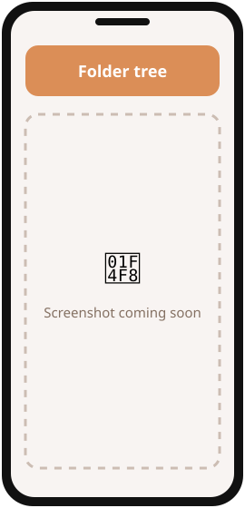
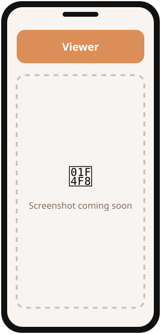
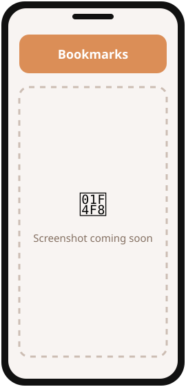

<div align="center">


# galleryFlows

**An Android gallery that browses your real folder tree: Folder › Subfolder › … › Images.**

  

[](https://github.com/Iurika-N-T-R/galleryFlows/releases/latest)
[](https://github.com/Iurika-N-T-R/galleryFlows/releases)
[](LICENSE)
[](https://github.com/Iurika-N-T-R/galleryFlows/stargazers)

[**⬇️ Download**](#download) · [**📸 Screenshots**](#screenshots) · [**✨ Features**](#features) · [**🛠️ Build**](#build)

</div>

---

<a id="screenshots"></a>

## 📸 Screenshots

<!-- TODO: replace docs/assets/screenshot-N.svg with real screenshots (same size for all, e.g. 1080x2400) -->
<div align="center">
<table>
  <tr>
    <td align="center"><br><sub><b>Folder tree</b></sub></td>
    <td align="center"><br><sub><b>Viewer</b></sub></td>
    <td align="center"><br><sub><b>Bookmarks</b></sub></td>
  </tr>
</table>
</div>

---

## 💡 What is galleryFlows?

galleryFlows helps **people with lots of organized pictures** walk through their **real folders, level by level**,
without the flat "every folder in one list" view of most galleries (`Camera`, `Screenshots`, `Wallpapers`…
and you never see how they are nested). It works like a file manager that only shows your media.
It is free, open source, has no internet permission and contains no ads or trackers.

> galleryFlows is an independent app written from scratch, with no dependencies.
> It is not affiliated with Fossify or Simple Mobile Tools.

### 👥 Who is it for?

- 🎨 **Artists** with reference folders nested by theme (Art › Characters › Hands…)
- 📷 **Photographers** who sort shoots into folders and subfolders
- 🗃️ **Anyone leaving Fossify / Simple Gallery** who wants everything it does, plus a real tree

---

<a id="features"></a>

## ✨ Features

| | Feature | Description |
|:-:|---|---|
| 🌳 | **Real folder tree** | Subfolders as cards with a cover and the media count of the whole subtree |
| 🧭 | **Breadcrumb** | Jump back to any level; Back keeps your scroll position |
| 🔖 | **Bookmarks** | Group folders and images into collections like *Art* or *References* |
| 🗂️ | **Groups** | Virtual folders in the tree: move folders into them inside the app, nothing moves on disk |
| 🖼️ | **Full viewer** | Zoom to full resolution, RAW, SVG, GIF, videos with gestures |
| ✂️ | **Editor** | Crop, rotate, flip, brightness / contrast / saturation — EXIF kept |
| 🗑️ | **Trash** | Instant delete, restore where it was, auto-clean after 30 days |
| 🔐 | **App lock** | Fingerprint, face or PIN for the app or hidden items |
| 🔒 | **Private by design** | No internet permission — nothing leaves your phone |

<details>
<summary><b>📖 Full guide — every screen and option</b></summary>

**Main screen**: your favorites, the folders you added (DCIM and Pictures at first), and the trash. **⋮ → Ajouter un dossier** adds any folder from internal storage or the SD card.

**Inside a folder**
- Subfolders come first, as cards with a cover and the number of media in the **whole subtree**; then the folder's own pictures and videos. Folders with no media anywhere below them are left out.
- A folder with nothing of its own but a single subfolder opens straight into that subfolder (as many levels down as it goes); Back skips them on the way up too.
- The **breadcrumb** (`Galerie › Pictures › Media › Selfgrow`) jumps back to any level; Back goes up one level and keeps your scroll position.
- **Search** looks through the current folder and everything below it, for files or (a setting) for folders.
- **Long press** a media to select several, and keep the finger down to slide over the others: everything between is selected (near the top or bottom edge the grid scrolls by itself; slide back to unselect). Then bookmark, share, copy, move, delete. Copy and move open "Sélectionner la destination": every folder with media as a card with its cover (recent destinations first), a search field, the eye for hidden folders; a tap picks the folder, "Autre dossier" browses to any other.
- **Long press** a folder: pin it at the top, rename, hide it (`.nomedia`), exclude it, add it to the main screen, or create a home-screen shortcut to it.

**Bookmarks** (swipe right anywhere on the grid, or the bookmark button next to the search bar, opens the sidebar; swipe left closes it): long-press a folder, or select images, then "Ajouter à un bookmark" to put them in a bookmark such as *Art* or *Références*, new or existing. Bookmarks also sit in a row of thumbnails under the search bar, on the main screen and inside a bookmark, to jump from one to another. Opening a bookmark shows only its folders and images; from there you browse into them as usual, and Back comes back to the bookmark.

**Groups** (⋮ → "Créer un groupe", or long-press a folder → "Déplacer dans un groupe"): a virtual folder shown as a card right where you create it, on the main screen or inside any folder. Folders moved into it leave their usual place and appear in the group instead; nothing moves on disk. "Retirer de « … »" inside the group puts a folder back. Selecting several folders and adding them to a group works too. A group can't end up inside a folder it holds: it moves up to where that folder was shown. Groups also appear in the sidebar with the bookmarks.

**⋮ menu**: sort (name, location, dimensions, size, modified date, date taken, random, or custom: long-press items and put them first; ascending or descending), filter (images, videos, GIF, RAW, SVG, portrait shots), grid or list, 1 to 20 columns for folders and for media, show hidden files, new folder, shuffle, settings.

**Viewer**
- Swipe left / right for the next / previous media, swipe down to close, pinch or double-tap to zoom (optionally to 1:1), turn with two fingers, tap to show or hide the bars. Zoomed in, the visible part is reloaded at the file's full resolution.
- Bottom bar: you pick its buttons (favorite, edit, share, delete, properties by default).
- **⋮**: everything else: copy, move, rename, rotate (lossless for JPEG), resize, edit with another app, hide, open with, set as wallpaper / contact photo, show on map, print, slideshow, home-screen shortcut, orientation (system, portrait, landscape, or following the media).
- RAW photos show their embedded preview when Android can't decode them; SVG drawings are rendered by the system WebView.
- **Videos**: play / pause, seek bar, resume where you stopped, loop and autoplay options; drag up / down on the left half for brightness, on the right half for volume.

**Editor**: crop (free, original, 1:1, 4:3, 3:4, 16:9, 9:16), rotate, flip, brightness / contrast / saturation. Replace the original or save a copy; the date taken and GPS position are kept.

**Trash**: deleted media go to a hidden trash folder on their own storage (so deleting a large video is instant). Restore puts them back where they were; anything older than 30 days is removed for good.

**Settings**: accent and background colors, English instead of French, date and time format, thumbnail size (fast / balanced / best quality), thumbnails (square crop, animated GIFs, square / rounded / circle styles), horizontal scrolling, pull to refresh, videos, fullscreen (max brightness, black background, auto-hide, tap the sides to change media, brightness by vertical drag, swipe down to close, notch, details overlay, slideshow speed), zoom, viewer action bar, security (lock the app, hidden items, or delete / move operations behind your fingerprint, face or PIN), file operations, trash, thumbnail cache, export / import of favorites and of all settings.

Thumbnails are kept in the app's own storage (up to 1 GB, least recently used dropped first), not in its cache, which Android empties whenever storage runs low.

**With other apps**: "Open with galleryFlows" opens a file and lets you swipe through the rest of its folder; apps that ask for a picture or a video can use galleryFlows as the picker.

</details>

---

<a id="download"></a>

## ⬇️ Download

<div align="center">

<a href="https://github.com/Iurika-N-T-R/iurikaFlows/releases/latest">
  
</a>
&nbsp;
<a href="https://github.com/Iurika-N-T-R/galleryFlows/releases/latest">
  
</a>

</div>

### 🟢 Recommended: with iurikaFlows (automatic updates)

1. Install **iurikaFlows** → [download here](https://github.com/Iurika-N-T-R/iurikaFlows/releases/latest).
2. Open it and find **galleryFlows** in *Découvrir*.
3. Tap **Install**. Future updates arrive automatically. ✅

### 🔵 Manual install (APK)

1. Go to the [**latest release**](https://github.com/Iurika-N-T-R/galleryFlows/releases/latest).
2. Under **Assets**, download the file ending in **`.apk`**.
3. Open it on your phone. If Android asks, allow **"Install unknown apps"** for your browser/file manager.
4. Tap **Install**. Done! 🎉

On first launch, allow **access to all files**: galleryFlows reads folders directly (internal storage and SD card) instead of going through the system media index, which is what makes the folder tree possible.

<details>
<summary><b>❓ Why isn't it on the Play Store?</b></summary>
<br>
galleryFlows is an independent, free project. Instead of the Play Store, it is distributed through
GitHub Releases and <b>iurikaFlows</b>, a small open-source store that keeps all my apps up to date.
The APKs are built from this public source code — you can check everything.
</details>

<details>
<summary><b>🛡️ Is it safe? Android says "unknown source"</b></summary>
<br>
This warning appears for every app installed outside the Play Store. The code is 100% public in this repository,
and each release is signed with the same key, so Android will refuse any modified version.
</details>

> **Requirements:** Android 11+ · ~2.3 MB

---

<a id="build"></a>

## 🛠️ Build from source

<details>
<summary><b>For developers — click to expand</b></summary>

**Prerequisites:** [Android Studio](https://developer.android.com/studio) (latest) or the Android SDK (platform 36) · JDK 17–21

```bash
git clone https://github.com/Iurika-N-T-R/galleryFlows.git
cd galleryFlows
./gradlew assembleDebug
```

The APK is generated in `app/build/outputs/apk/debug/`.

**Signed release:** `./gradlew assembleRelease` signs the APK only if a git-ignored `keystore.properties`
(`storeFile`, `storePassword`, `keyAlias`, `keyPassword`) sits at the project root; otherwise it comes out unsigned.

**Permissions**
- `MANAGE_EXTERNAL_STORAGE` (all files access): browse real folders, and copy, move, rename or delete files in them.
- `USE_BIOMETRIC`: the optional app lock.

</details>

---

## 🤝 Contributing

Ideas, bugs, translations — all contributions are welcome!

- 🐛 **Found a bug?** → [Open an issue](https://github.com/Iurika-N-T-R/galleryFlows/issues/new)
- 💡 **Have an idea?** → [Open an issue](https://github.com/Iurika-N-T-R/galleryFlows/issues) and describe it
- ⭐ **Like it?** → A star on this repo helps other people find it!
- ☕ **Want to support the work?** → [Buy me a coffee](https://buymeacoffee.com/iurika)

---

## 🧩 More apps by Iurika-N-T-R

<!-- Same block in EVERY repo: cross-linking boosts visibility of all the projects -->
| App | Description |
|---|---|
| [**iurikaFlows**](https://github.com/Iurika-N-T-R/iurikaFlows) | My open-source app store — installs and updates all my apps |
| [**DroRef**](https://github.com/Iurika-N-T-R/DroRef) | Reference board for artists, opens and saves PureRef `.pur` files |
| [**OnlyFlows**](https://github.com/Iurika-N-T-R/OnlyFlows) | Offline-first task & project manager with LAN sync |
| [**ColorFlows**](https://github.com/Iurika-N-T-R/ColorFlows) | Color harmonies, palettes from pictures, painter's shading sphere |
| [**vidéoFlows**](https://github.com/Iurika-N-T-R/videoFlows) | Your own videos in a vertical swipe feed |
| [**RandomFlows**](https://github.com/Iurika-N-T-R/RandomFlows) | Randomizer & decision maker on your own lists |
| [**Brush Converter**](https://github.com/Iurika-N-T-R/ABR-to-PRZP-Brush-converter) | Photoshop `.abr` brushes → Infinite Painter `.przp`, in the browser |

---

<div align="center">

📄 Released under the **[MIT License](LICENSE)**

Made with ❤️ by [**Iurika-N-T-R**](https://github.com/Iurika-N-T-R)

<sub>If galleryFlows is useful to you, consider giving it a ⭐ — it really helps!</sub>

</div>
